# Bluffing Against Strangers — safe opponent exploitation in reduced Bluff (Group 35)

Approximate CFR+ equilibrium strategies with exact full-tree best responses and
exploitability calculations (per seat), an exact Bayesian filter over opponent types
(hidden cards marginalised), realization-plan mixing with an
enforced per-seat exploitability cap, and the experiments E1–E5 of the report
(`report/final_report.pdf`). Results with images: see [Results](#results-generated-by-python-plotspy).

## Environment (verified)

| | version |
|---|---|
| Python | 3.13.18 (full pipeline run); 3.12.3 also verified (tests + `plots.py`, identical outputs) |
| numpy | 2.5.3 |
| matplotlib | 3.11.2 |
| pytest | 9.1.1 |

All versions, including matplotlib's and pytest's own dependencies, are pinned in
`requirements.txt`. No other packages are used. LaTeX (TeX Live with `mathptmx`,
`algorithm2e`, `natbib`, `placeins`) is needed only to recompile the PDFs.

## Reproduce everything from scratch

Repository: https://github.com/Sejal-Kadgi/FAI

```bash
git clone https://github.com/Sejal-Kadgi/FAI.git && cd FAI
python3.13 -m venv .venv && . .venv/bin/activate     # or python3.12; Windows: py -3.12 -m venv .venv && .venv\Scripts\activate
pip install -r requirements.txt
python -m pytest        # 58 unit and regression tests, no cached data needed
                        # (about 7-20 s depending on the machine: 7-9 s and ~19 s in our two
                        #  test environments; under a minute on typical hardware)
python run_all.py       # full E1-E5 pipeline, then all figures/tables/numbers
```

`run_all.py` clears `results/cache/`, recomputes the CFR+ equilibria and RNR solutions, and
runs E1, E2, E3 (testbed S), E4, E5 and E3 (testbed L) in that order. Per-step logs are written
to `results/*.log`, and versions and timings to `results/run_info.json`. It uses 2 worker
processes. The verification run on 2 CPU cores took 1.87 hours in total (E1 5 min, E2 10 min,
E3-S 4 min, E4 39 min, E5 38 min, E3-L 15 min).

To regenerate every figure, table and report number from saved results **without rerunning**:

```bash
python plots.py
```

Then recompile the report: `cd report && pdflatex final_report.tex && pdflatex final_report.tex`.
The report reads its tables (`results/*_table.tex`, `results/e1_*.tex`) and every result number
quoted in its text (`results/numbers.tex`) from generated files; no result is typed by hand.

## Screenshots: the code running on Windows (Python 3.12)

Tests (`python -m pytest`):

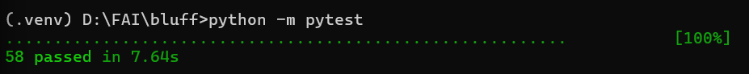

Figures, tables and report numbers regenerated from the saved results (`python plots.py`):

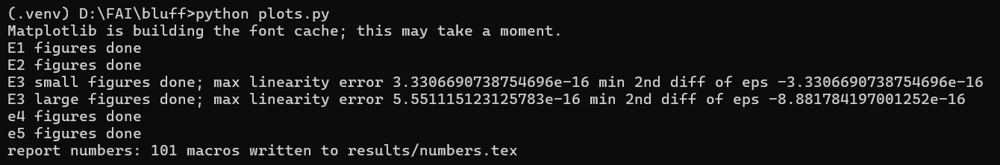

Check that the regenerated report numbers equal the shipped ones (same machine):

```
(.venv) D:\FAI\bluff>python -c "import json; print(json.load(open('results/numbers.json')) == json.load(open('results_shipped/numbers.json')))"
True
```

## Verify the results yourself

The repository ships the raw results of our full run, so you can check the report at two levels.
Keep a copy of the shipped outputs first (`run_all.py` overwrites them):

```bash
cp -r results results_shipped && cp -r figures figures_shipped
python plots.py      # level 1 (~1 min): rebuild every figure/table/number from the raw results
python run_all.py    # level 2 (~2 h): rerun E1-E5 from scratch, then rebuild everything
diff -r results_shipped results
for f in figures/*.png; do cmp -s "$f" "figures_shipped/$(basename "$f")" || echo "differs: $f"; done
```

Expected: everything is identical except wall-clock timings (`seconds` in `e1.json`, the time
column of `e1_sizes.tex`, `secS`, `msIterS`, `msIterL`, `pipelineHours` in `numbers.json`,
`run_info.json`) and the `.log` files. Figures are byte-identical in the pinned environment
from `requirements.txt`. We verified this on Linux with Python 3.13; other platforms may differ
in the last floating-point digit. Recompile the report afterwards to see your own numbers in it.

## Results (generated by `python plots.py`)

All images below are produced from `results/` by the code in this repository; the report
(`report/final_report.pdf`) uses the same files.

**E1: CFR vs CFR+ convergence on the three game sizes.**
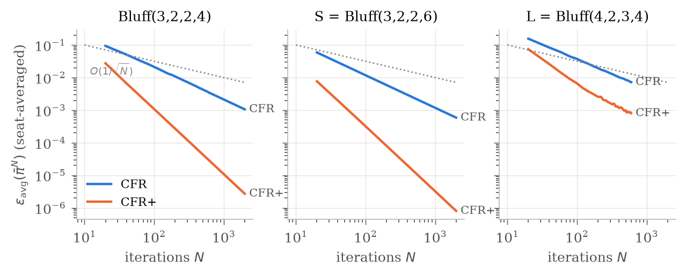

**E2: identification of the opponent type; the calling propensity is learned faster than the bluffing propensity.**
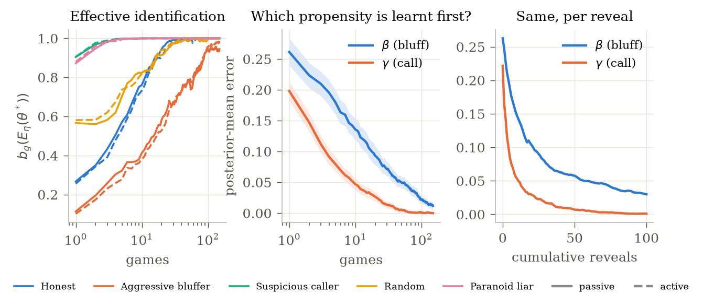

**E3: exploitation/exploitability frontier on S, and price of safety vs. ignorance.**
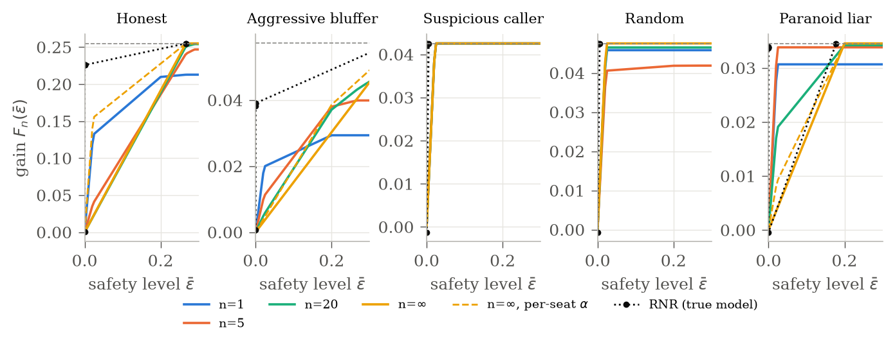
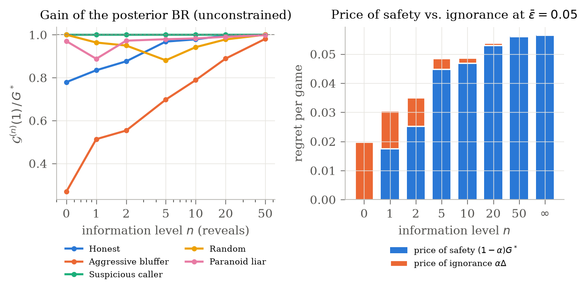

**E3 on the larger game L.**
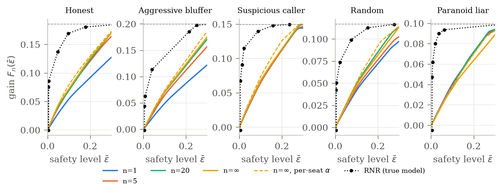

**E4: learner comparison (grouped; only the safety-capped group enforces eps_max <= 0.05).**
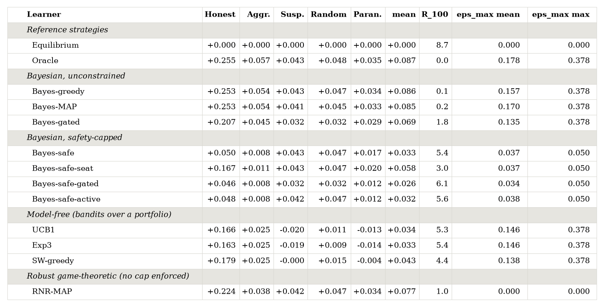
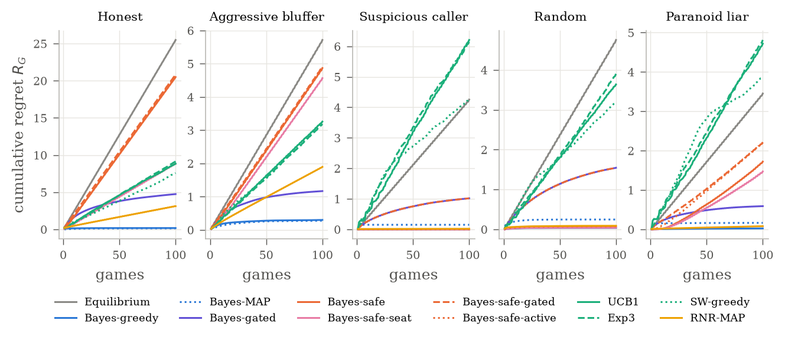
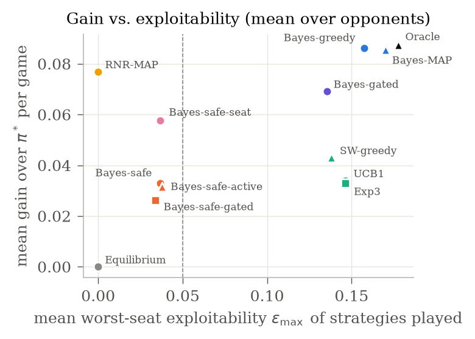

**E5: opponents outside the type grid.**
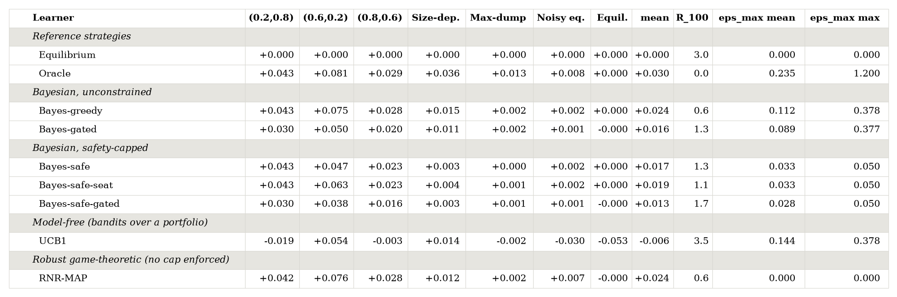
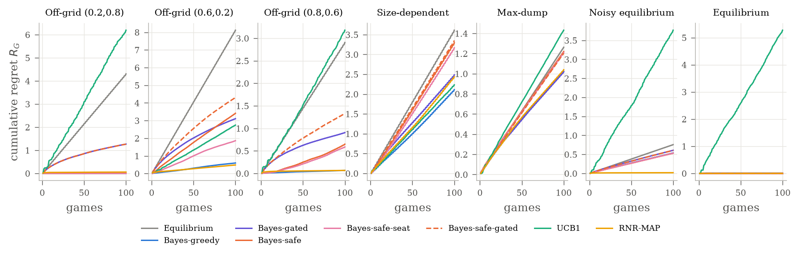

## Configuration and seeds

| | value | where |
|---|---|---|
| testbeds | S = Bluff(3,2,2,6), L = Bluff(4,2,3,4); both leave 2 cards undealt | `experiments/common.py` |
| equilibrium | CFR+, 2000 iterations (S, tiny), 600 (L) | `EQ_ITERS` in `common.py` |
| safety level | eps_bar = 0.05 | `EPS_BAR` in `common.py` |
| information bonus | lambda = 0.2 (fixed in advance, not tuned; only value run) | `LAM` in `e2_ident.py`, `e45_learners.py` |
| RNR | p = 0.5, 300 CFR+ iterations per seat and grid type (E4/E5); E3: p in {0,…,1}, 300 (S) / 150 (L) iterations | `e45_learners.py`, `e3_frontier.py` |
| type grid | {0.1,0.3,0.5,0.7,0.9}^2, uniform prior | `bluff/opponents.py` |
| E2 | 150 games, 30 seeds, eta = 0.01 | `e2_ident.py` |
| E3 | 21 alpha grid points; 20 (S) / 8 (L) belief samples per information level | `e3_frontier.py` |
| E4 / E5 | G = 100 games, 30 seeds | `e45_learners.py` |

Seeds are fixed per job with `numpy.random.default_rng` seed tuples (E2: `[seed, type, 7]`, deals
`[seed, type, 8]`; E3: `[seed, type, n, 11]`; E4/E5: `[seed, opponent, 101]`, deals
`[seed, opponent, 202]`). Deals come from a separate stream, so all learners face the same deals.
Results are saved in a fixed order, so reruns reproduce the same numbers. Only wall-clock
timings (`seconds` in `results/e1.json`, Table 1 of the report) depend on the machine.

## Layout and expected outputs

```
bluff/          game.py (rules, flattened tree), solvers.py (CFR/CFR+, BR, exploitability,
                RNR, mixing), opponents.py (types), agents.py (filter, alpha cap, learners, simulator)
experiments/    common.py, e1_cfr.py, e2_ident.py, e3_frontier.py, e45_learners.py,
                make_figures.py (figures + tables), report_numbers.py (report text numbers)
tests/          pytest suite; tests/reference/bluff_v0.py = original implementation (regression)
docs/           screenshots of the tests and plots.py running (Windows, Python 3.12)
run_all.py      full pipeline          plots.py   figures/tables/numbers from saved results
results/        e1.json, e2.pkl, e3_small.pkl, e3_large.pkl, e4.pkl, e5.pkl (raw results)
                e3_*_summary.json, e4_summary.json, e5_summary.json, numbers.json (processed)
                e1_sizes.tex, e1_fb1.tex, e2_table.tex, e4_table.tex, e5_table.tex, numbers.tex
                cache/ (equilibria, RNR library; recomputed by run_all.py), *.log, run_info.json
figures/        e1_cfr, e2_ident, e2_loss, e3_frontier_small, e3_voi_small, e3_frontier_large,
                e3_voi_large, e4_regret, e4_scatter, e5_regret, e5_scatter (each .pdf and .png),
                e4_table.png, e5_table.png (result tables rendered from the same data)
report/         final_report.tex/.pdf  (the project-review report, completed with Methodology,
                Results and Contribution); plan_revised.tex/.pdf (the revised plan after review)
```

## Game rules and information visibility

Two players; K ranks with m copies; each player gets h cards and Km − 2h cards stay undealt.
At play t the player t mod 2 puts 1..min(m, hand) cards face down claiming rank t mod K; the
other player accepts or calls; on a call the liar (or the caller, if the claim was true) takes
the pile. Emptying your hand wins if the last play is accepted or called and true; after T plays
the player with fewer cards wins (equal = draw).

What each player observes (this is the observation model of the Bayesian filter, which is built
from the engine's own observation classes, so the two cannot disagree):
* cards are tracked by **rank only**; a player knows its own hand;
* for an opponent's play it sees only the **claim size**;
* a **call reveals the played cards to both players**; the player who **collects the pile sees
  all its cards**, the other player learns only **how many** were collected;
* **undealt cards and final hands are never revealed**.

`tests/test_rules.py` checks these rules (and card conservation, transitions, payoffs, and a
hand-worked game) on the readable observation records (`Game(..., keep_obs=True)`).

## Safety mechanism

The cap is enforced on the **worst seat**, eps_max = max(eps_0, eps_1), not on the seat
average. Because the CFR+ equilibrium is only approximate, v* is bracketed by exact
best-response values of x*, and each eps_i is replaced by a certified upper bound
(`solvers.seat_exploitability`). Three methods (`agents.alpha_cap`): `chord` (common alpha,
guaranteed by convexity), `bisect` (tight common alpha), `chord-seat` (separate alpha per seat).
An eps_bar below eps_max(x*) raises `InfeasibleSafetyLevel`. The guarantee concerns the
*expected* payoff of each game in each seat (u_i ≥ v_i* − eps_bar against any opponent), not
individual outcomes. `exploitability()` (the seat average) is only used to report CFR convergence.

## Assumptions and limits

* Two-player, reduced game: everything is computed exactly on the full tree, which limits the
  game size (largest tree 677,837 nodes).
* The opponent's type is fixed for the whole match; E5 tests opponents outside the type grid.
* lambda = 0.2, eps_bar = 0.05 and RNR's p = 0.5 were set in advance and not tuned.
* RNR-MAP's low exploitability is observed, not enforced by a cap.

## Complexity

N tree nodes (S: 95,581; L: 677,837), |Theta| = 25. Reach, value and best-response passes are
O(N) vectorised work per tree level; a CFR+ iteration is a constant number of passes;
exploitability is two best-response passes. The filter precomputes 2|Theta| reach passes and
stores O(|Theta| N) floats per seat (about 270 MB on L); afterwards each update is O(|Theta|).
An RNR solve is O(iterations × N).

## Note on an earlier version

An earlier version enforced the cap on the seat-averaged exploitability, which does not bound
each seat. This was corrected (worst-seat metric, certified bounds), and E2–E5 were re-run.
`tests/test_safety.py::test_average_metric_would_not_be_safe` guards against the regression.
